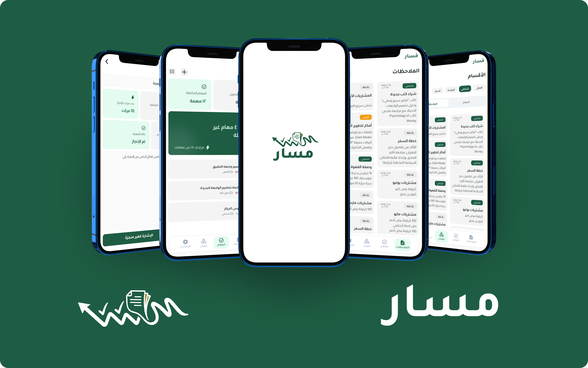

# 🧭 Masar – Notes & Task Management App

Masar is an offline-first productivity application built with Flutter, designed to help users organize their notes, manage tasks, and track their daily performance. It provides a structured way to manage notes and tasks through customizable categories, flexible task recurrence settings, and productivity statistics.

## ✨ Features

* **📝 Notes Management**

  * Create, edit, and organize notes.
  * Assign notes to specific categories for better organization.

* **✅ Task Management**

  * Create and manage tasks with flexible scheduling options.
  * Configure task due dates and recurrence settings.
  * Customize recurrence intervals, repetition frequency, and the number of repetitions.

* **📊 Productivity Statistics**

  * Track task completion rates.
  * Monitor daily task counts.
  * View performance statistics to better understand productivity and progress.

* **📂 Categories**

  * Organize notes and tasks into dedicated categories.
  * Assign a distinct color to each category for easy identification.

* **⚙️ Settings**

  * Access application settings and customize available preferences.

* **📴 Offline Support**

  * Store data locally using Hive.
  * Access and manage notes, tasks, and categories without an internet connection.

## 🛠️ Architecture & Tech Stack

* **Framework & Language:** Flutter & Dart
* **Architecture:** MVVM with Feature-Based Architecture
* **State Management:** Cubit
* **Local Database:** Hive
* **Design Pattern:** Singleton
* **Dependency Management:** Dependency Injection (DI)

## 🏗️ Architecture Overview

Masar follows the **MVVM (Model-View-ViewModel)** pattern alongside a feature-based project structure to keep the code organized, modular, and maintainable.

The application separates its functionality into independent features, while Cubit manages UI state and Hive provides local data persistence for offline usage.

## 📱 Behance

  

Check out the full UI/UX design and project presentation on Behance:

  

**Omar Ramadan**

[GitHub Repository](https://github.com/OmarRamadan32/Masar)
